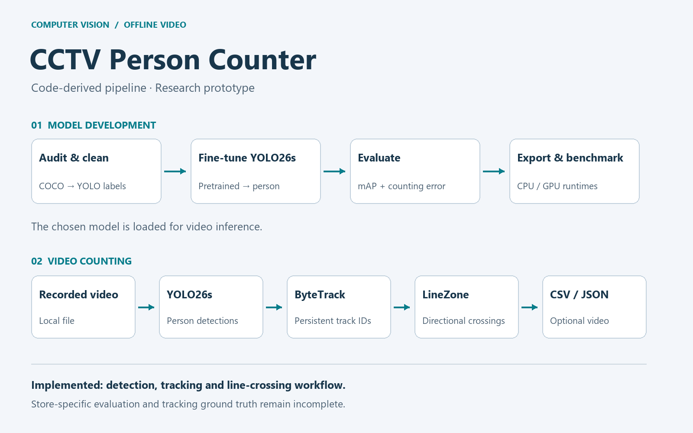
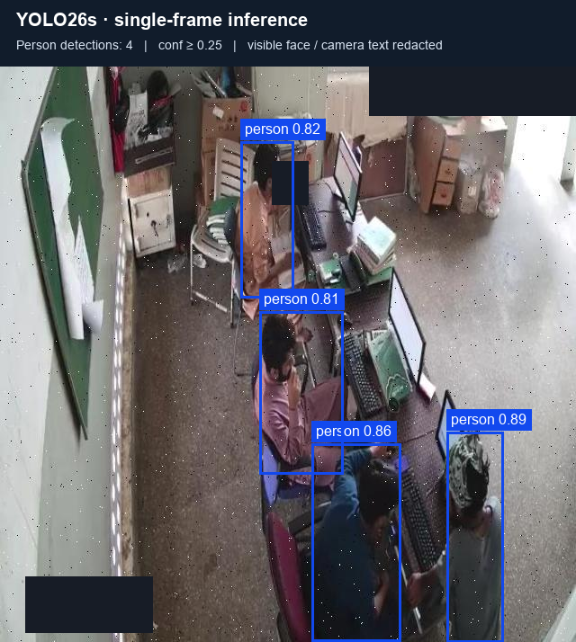

# CCTV Person Counter

A computer vision pipeline for counting people in recorded indoor CCTV footage. It combines YOLO26s fine-tuning, tracking, line-crossing counts, dataset auditing, and runtime benchmarking, with documented limits on real-camera performance.

Research prototype; store-camera validation incomplete.

## 1. Overview

Investigate per-frame person counting and directional footfall from a fixed indoor CCTV viewpoint.

Store operators and computer-vision developers evaluating recorded CCTV footage.

This is an offline computer-vision project composed of Python command-line programs. Its report pages present experiment outputs; they are not a deployed store-management application.

## 2. Problem

A useful store counter must distinguish the number visible now from line-crossing events and tracker identities. The initial CCTV dataset contained augmented duplicates, mixed categories, and split leakage; strong test scores also failed to predict the behavior of seated and occluded people in warehouse footage.

## 3. Personal contribution

Naufal Firdaus designed and implemented the custom project pipeline, including dataset auditing and cleaning, experiment configuration, evaluation, export and runtime comparisons, video counting, and store-data preparation. Authorship and the victoriavals account identity were confirmed by the owner. The project uses third-party libraries, pretrained YOLO26s weights, and a Roboflow dataset; the detector is fine-tuned rather than trained from scratch.

## 4. Features and workflow

- Audit augmented duplicates and rebuild a single-person dataset with scene-grouped splits.
- Fine-tune pretrained YOLO26s and compare default, reduced-augmentation, and indoor-only experiments.
- Evaluate detection and per-frame counting using mAP, precision, recall, MAE, RMSE, bias, and within-one-person results.
- Track detections with ByteTrack or BoT-SORT and count directional line crossings in recorded video.
- Export models and compare PyTorch, ONNX Runtime, OpenVINO, and TensorRT on local CPU and GPU hardware.
- Sample store-camera frames, generate draft labels, and merge manually corrected labels for a later fine-tuning run.

A user first prepares authorized footage and a matching single-person model, then selects a counting line. The counter processes successive frames and produces counts and optional overlays. Draft labels for adaptation require manual correction before training.

Occupancy, crossing totals, and cumulative tracker IDs are separate outputs. The same person can receive a new tracking ID after a lost association, so cumulative IDs are not validated unique-visitor counts.

## 5. Engineering focus

- Treat data leakage and mixed annotations as engineering problems before comparing model scores.
- Measure counting error separately from object-detection quality and tracking identity counts.
- Compare inference runtimes using exported graph sizes, warm-up, sampled detection matching, and local timing.
- Document the gap between public-dataset results and the behavior of seated or partially occluded people on a store-like camera.

## 6. Architecture

Standalone Python CLI stages exchange files. The development branch audits and cleans data, fine-tunes pretrained YOLO26s, evaluates outputs, and exports models. The video branch loads a model backend, tracks detections with ByteTrack or BoT-SORT, updates a Supervision LineZone, and writes CSV, JSON, and optional annotated video. A static report server is a viewing helper, not an inference API.

The diagram is reconstructed documentation of code relationships, not a screenshot of a running deployment.

## 7. Implementation

**Dataset reconstruction.** A histogram-based audit clusters copies within filename stems; cleaning keeps one representative, maps person categories, drops shoe annotations and non-CCTV families, and exports COCO and normalized YOLO labels.

`tools/audit_duplicates.py`, `tools/clean_cctv.py`, `tools/families.py`

**Experiment configuration.** COMMON and RUNS define shared training settings and explicit overrides. The progress monitor reads existing CSV logs for the three public-data experiments.

`tools/train.py`, `tools/status.py`

**Evaluation and reporting.** COCO evaluation measures detection; confidence-ordered matching and count differences measure counting. Predictions are cached as NPZ for report figures without repeated inference.

`tools/evaluate.py`, `tools/make_eval_figures.py`, `tools/make_figures.py`

**Video counting.** model.track uses persistent streaming results. Supervision LineZone maintains in/out crossing totals; the script writes per-frame CSV, summary JSON, and optional annotated MP4.

`tools/count_people.py`

**Runtime experiments.** Exports are staged by format and input size. The comparison tools collect prediction timings and cached video detections; the video renderer does not provide tracking ground truth.

`tools/export.py`, `tools/benchmark_backends.py`, `tools/compare_backends_video.py`, `tools/make_backend_figure.py`

**Store adaptation and static reports.** Frame sampling, draft labeling, time-block merging, and a store training configuration exist. Store-specific evaluation remains missing. The HTTP helper only serves static report files.

`tools/prepare_labeling.py`, `tools/merge_store_data.py`, `tools/serve_reports.py`, `reports/`

## 8. Technical decisions

**Deduplicate before splitting.** The source audit reports 10,062 files representing 4,886 photo clusters and copies shared across the original splits. The 0.97 histogram-similarity rule is heuristic and is applied within filename-stem groups; it does not prove universal deduplication.

**Group splits by scene and stratify by domain and density.** The intended 80/10/10 allocation keeps frames from a named scene together while balancing the target indoor share. The 142 semi/entrance images are all in train; entrance-specific performance is not measured on validation or test.

**Retain the default experiment.** The recorded default result has lower aggregate counting MAE than the reduced-augmentation and indoor-only runs. These are recorded experiments with a single configured seed, not a repeated-run statistical comparison or a universal rule about augmentation.

**Choose confidence using counting error.** The product goal is counting; the evaluator compares MAE and F1 over confidence thresholds. The stored operating point was selected on the same test split. A future evaluation should choose it on validation before testing.

**Stage exports and inspect fixed graph dimensions.** Ultralytics exports beside the weights; later resolutions can overwrite earlier files. The inspected copies include both 640 and 416 pixel OpenVINO graphs. An imgsz argument does not replace the dimensions baked into a fixed export. Device and graph selection still need explicit checking.

**Use local runtime measurements to guide backend choice.** The historical sample favors OpenVINO for this CPU and TensorRT for this GPU; ONNX Runtime CPU was substantially slower on this workstation. The 40-image parity result is sample-specific; crowded-video caches show different detection totals. Prediction throughput is not whole-pipeline throughput.

## 9. Evidence and results

Actual local YOLO26s inference returned 4 person detections in one selected dataset frame at image size 640 and confidence threshold 0.25 on CPU. Blue labels are returned confidence scores. One visible facial profile and camera text are redacted; back-of-head views are retained. This still image does not demonstrate tracking, unique visitors, or entry/exit accuracy.

[Usage and inference evidence](technical/person-counter-example.md).

| Model | Confidence | mAP50 | Counting MAE | Within ±1 |
|---|---:|---:|---:|---:|
| baseline | 0.15 | 0.644 | 1.600 | 65.9% |
| default | 0.25 | 0.891 | 0.640 | 88.0% |
| tuned | 0.20 | 0.873 | 0.659 | 85.7% |
| indoor | 0.15 | 0.679 | 1.322 | 68.2% |

The table reports historical test results on 475 images with 1,844 boxes. Confidence was tuned on the test set, so these are exploratory operating-point results. The mAP figures were not regenerated during this handoff.

**Recorded test-split detector result.** Default: mAP50 0.8907, mAP50–95 0.5842, confidence 0.25, 475 images and 1,844 annotated people. mAP was read from the historical report, not recomputed from a new inference run.

**Cached counting metrics independently checked.** Recalculation from cached predictions matches the stored counting and precision/recall metrics for seven model/size outputs. Default MAE is 0.640, within-one is 88.0%, and exact-count share is 55.58%. This checks cached outputs, not current live-camera inference.

**Dataset and artifact checks.** Local checks find 4,746 images, 18,445 boxes, no scene assigned to multiple splits in the manifest, matching COCO/YOLO labels, and matching committed model checksums. The unbundled inputs are identified by hashes.

**Historical local runtime comparison.** On the recorded 40-image, 640-pixel benchmark, OpenVINO CPU is about 19.9 FPS and TensorRT GPU about 78.3 FPS. These are local prediction-call measurements, not tracking accuracy or production throughput.

Historical field check: a 900-frame warehouse demo averaged 2.35 tracked-result detections and 40 cumulative track IDs. The README describes 5–7 visible people and about six individuals by visual inspection. This is evidence of a domain gap, not a labeled tracking-accuracy measurement.

One additional local detector inference was performed for the selected single-frame illustration. No new training or complete video-counting run was performed; the historical mAP and benchmark figures were not regenerated.

## 10. Limitations

- Real-camera counting is not validated for operational use. Historical warehouse output undercounts compared with the visual estimate in the README.
- The dataset has no track IDs, no empty images, and limited target-camera coverage. Unique tracker IDs do not establish unique visitors.
- Store sampling, merging, and training configuration exist, but store-only evaluation, its error gallery, and store progress monitoring are not implemented.
- The counter accepts local video files and lacks explicit device and image-size CLI options. Occupancy is read from tracked results and can be influenced by tracker filtering.
- The fallback shared ID of -1 can create false crossings. The store learning-rate override can be ignored by optimizer=auto in the installed Ultralytics version.
- Legacy dataset paths and some reports are stale. There is no original dependency manifest, automated test suite, or verified deployment configuration.
- Full dataset and model redistribution rights are unverified. Only one privacy-redacted example frame is included at the user's explicit direction. Training data, annotations, prediction caches, raw video, and model binaries remain excluded, so the ZIP alone cannot reproduce training or inference.

Source and evidence: [reviewed Python source](https://github.com/victoriavals/yolo26-cctv-person-counter/tree/624a840b2de026585d7da4bd9bfeb5f92f8984fd/tools), [aggregate evidence](technical/aggregate-evidence.json), and [evidence ledger](internal/evidence.md).
