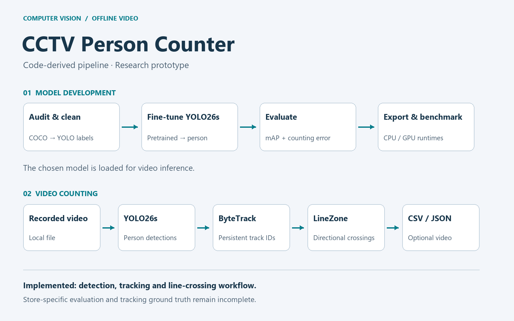
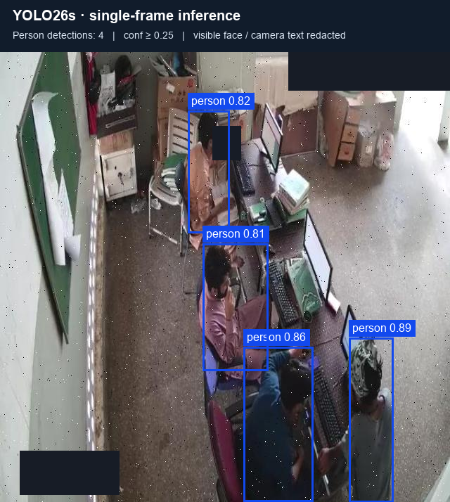

# Penghitung Orang CCTV

Pipeline visi komputer untuk menghitung orang pada rekaman CCTV dalam ruangan. Proyek ini mencakup fine-tuning YOLO26s, tracking, penghitungan lintasan, audit dataset, dan benchmark runtime, dengan keterbatasan performa pada kamera nyata yang didokumentasikan.

Prototipe riset; validasi kamera toko belum lengkap.

## 1. Gambaran umum

Mengkaji hitungan orang per frame dan lintasan pengunjung berdasarkan arah dari sudut pandang CCTV indoor tetap.

Operator toko dan pengembang visi komputer yang mengevaluasi rekaman CCTV.

Ini adalah proyek visi komputer offline yang terdiri dari program command-line Python. Halaman laporannya menyajikan keluaran eksperimen; bukan aplikasi manajemen toko yang sudah di-deploy.

## 2. Masalah

Counter toko yang berguna perlu membedakan jumlah yang terlihat saat ini dari peristiwa melintasi garis dan identitas tracker. Dataset CCTV awal memuat duplikasi augmentasi, kategori campuran, dan kebocoran split; skor test tinggi juga belum memprediksi perilaku orang duduk dan tertutup pada rekaman warehouse.

## 3. Kontribusi pribadi

Naufal Firdaus merancang dan mengimplementasikan pipeline custom proyek, termasuk audit dan pembersihan dataset, konfigurasi eksperimen, evaluasi, ekspor dan perbandingan runtime, counting video, serta persiapan data toko. Kepengarangan dan identitas akun victoriavals dikonfirmasi oleh pemilik. Proyek memakai library pihak ketiga, bobot YOLO26s pretrained, dan dataset Roboflow; detektor melalui fine-tuning, bukan training dari awal.

## 4. Fitur dan alur penggunaan

- Mengaudit duplikasi augmentasi dan membangun ulang dataset satu kelas person dengan split berbasis scene.
- Melakukan fine-tuning YOLO26s pretrained dan membandingkan eksperimen default, augmentasi dikurangi, serta indoor saja.
- Mengevaluasi deteksi dan hitungan per frame menggunakan mAP, precision, recall, MAE, RMSE, bias, dan hasil dengan selisih maksimal satu orang.
- Melacak deteksi dengan ByteTrack atau BoT-SORT dan menghitung lintasan garis berdasarkan arah pada rekaman video.
- Mengekspor model dan membandingkan PyTorch, ONNX Runtime, OpenVINO, serta TensorRT pada CPU dan GPU lokal.
- Mengambil sampel frame kamera toko, membuat label draft, dan menggabungkan label yang dikoreksi manual untuk fine-tuning lanjutan.

Pengguna terlebih dahulu menyiapkan rekaman yang berhak digunakan dan model satu kelas person yang sesuai, lalu menentukan garis hitung. Counter memproses frame berurutan dan menghasilkan hitungan serta overlay opsional. Label draft untuk adaptasi perlu dikoreksi manual sebelum training.

Occupancy, total lintasan, dan ID tracker kumulatif merupakan keluaran terpisah. Orang yang sama dapat memperoleh ID baru setelah asosiasinya hilang, sehingga ID kumulatif bukan hitungan pengunjung unik yang tervalidasi.

## 5. Fokus engineering

- Menangani kebocoran data dan anotasi campuran sebagai persoalan engineering sebelum membandingkan skor model.
- Mengukur galat hitungan secara terpisah dari kualitas deteksi objek dan jumlah identitas tracking.
- Membandingkan runtime inferensi dengan ukuran graph ekspor, warm-up, kecocokan deteksi sampel, dan pengukuran waktu lokal.
- Mendokumentasikan kesenjangan antara hasil dataset publik dan perilaku orang duduk atau tertutup sebagian pada kamera yang menyerupai toko.

## 6. Arsitektur

Tahap CLI Python mandiri bertukar berkas. Cabang pengembangan mengaudit dan membersihkan data, melakukan fine-tuning YOLO26s pretrained, mengevaluasi keluaran, dan mengekspor model. Cabang video memuat backend model, melacak deteksi dengan ByteTrack atau BoT-SORT, memperbarui Supervision LineZone, dan menulis CSV, JSON, serta video anotasi opsional. Server laporan statis adalah helper tampilan, bukan API inferensi.

Diagram merupakan dokumentasi yang disusun dari hubungan dalam kode, bukan screenshot deployment yang berjalan.

## 7. Implementasi

**Rekonstruksi dataset.** Audit berbasis histogram mengelompokkan salinan dalam stem nama berkas; pembersihan mempertahankan satu representasi, memetakan kategori orang, membuang anotasi sepatu dan keluarga non-CCTV, lalu mengekspor COCO dan label YOLO ternormalisasi.

`tools/audit_duplicates.py`, `tools/clean_cctv.py`, `tools/families.py`

**Konfigurasi eksperimen.** COMMON dan RUNS mendefinisikan setelan training bersama serta override eksplisit. Pemantau progres membaca log CSV yang tersedia untuk tiga eksperimen data publik.

`tools/train.py`, `tools/status.py`

**Evaluasi dan pelaporan.** Evaluasi COCO mengukur deteksi; pencocokan berdasarkan confidence dan selisih jumlah mengukur counting. Prediksi disimpan sebagai NPZ untuk gambar laporan tanpa inferensi berulang.

`tools/evaluate.py`, `tools/make_eval_figures.py`, `tools/make_figures.py`

**Counting video.** model.track menggunakan hasil streaming yang persisten. Supervision LineZone menyimpan total lintasan masuk/keluar; skrip menulis CSV per frame, JSON ringkasan, dan MP4 anotasi opsional.

`tools/count_people.py`

**Eksperimen runtime.** Ekspor dipisahkan menurut format dan ukuran input. Alat perbandingan mengumpulkan waktu prediksi dan deteksi video tersimpan; perender video tidak menyediakan ground truth tracking.

`tools/export.py`, `tools/benchmark_backends.py`, `tools/compare_backends_video.py`, `tools/make_backend_figure.py`

**Adaptasi toko dan laporan statis.** Pengambilan sampel frame, label draft, penggabungan blok waktu, dan konfigurasi training toko tersedia. Evaluasi khusus toko belum tersedia. Helper HTTP hanya melayani berkas laporan statis.

`tools/prepare_labeling.py`, `tools/merge_store_data.py`, `tools/serve_reports.py`, `reports/`

## 8. Keputusan teknis

**Dedup sebelum split.** Audit sumber melaporkan 10.062 berkas yang mewakili 4.886 cluster foto serta salinan yang tersebar pada split awal. Aturan kemiripan histogram 0,97 bersifat heuristik dan diterapkan dalam kelompok stem nama berkas; ini tidak membuktikan deduplikasi universal.

**Mengelompokkan split menurut scene serta stratifikasi domain dan kepadatan.** Alokasi 80/10/10 yang dituju menjaga frame dari scene bernama tetap bersama sambil menyeimbangkan proporsi indoor sasaran. Seluruh 142 gambar semi/pintu masuk berada pada train; performa khusus pintu masuk tidak diukur pada validation atau test.

**Mempertahankan eksperimen default.** Hasil default yang tercatat memiliki MAE counting agregat lebih rendah daripada run augmentasi dikurangi dan indoor saja. Ini adalah eksperimen tercatat dengan satu seed konfigurasi, bukan perbandingan statistik run berulang atau aturan universal mengenai augmentasi.

**Memilih confidence berdasarkan galat hitungan.** Tujuan produk adalah counting; evaluator membandingkan MAE dan F1 pada berbagai threshold confidence. Titik operasi tersimpan dipilih pada split test yang sama. Evaluasi berikutnya sebaiknya memilihnya pada validation sebelum test.

**Memisahkan ekspor dan memeriksa dimensi graph tetap.** Ultralytics mengekspor di samping bobot; resolusi berikutnya dapat menimpa berkas sebelumnya. Salinan yang diperiksa mencakup graph OpenVINO 640 dan 416 piksel. Argumen imgsz tidak mengganti dimensi yang sudah tertanam pada ekspor tetap. Pemilihan device dan graph tetap perlu diperiksa secara eksplisit.

**Menggunakan pengukuran runtime lokal untuk memandu pilihan backend.** Sampel historis lebih menguntungkan OpenVINO untuk CPU ini dan TensorRT untuk GPU ini; ONNX Runtime CPU jauh lebih lambat pada workstation ini. Hasil kesamaan pada 40 gambar bersifat khusus sampel; cache video ramai menunjukkan total deteksi berbeda. Throughput prediksi bukan throughput seluruh pipeline.

## 9. Bukti dan hasil

Inferensi YOLO26s lokal sebenarnya menghasilkan 4 deteksi orang pada satu frame dataset terpilih dengan ukuran gambar 640 dan confidence threshold 0,25 di CPU. Label biru adalah skor confidence yang dikembalikan model. Satu profil wajah yang terlihat dan teks kamera ditutup; tampilan belakang kepala dipertahankan. Gambar diam ini tidak membuktikan tracking, pengunjung unik, atau akurasi masuk/keluar.

[Cara penggunaan dan bukti inferensi](technical/person-counter-example.md).

| Model | Confidence | mAP50 | MAE hitungan | Dalam ±1 |
|---|---:|---:|---:|---:|
| baseline | 0.15 | 0.644 | 1.600 | 65.9% |
| default | 0.25 | 0.891 | 0.640 | 88.0% |
| tuned | 0.20 | 0.873 | 0.659 | 85.7% |
| indoor | 0.15 | 0.679 | 1.322 | 68.2% |

Tabel melaporkan hasil test historis pada 475 gambar dengan 1.844 kotak. Confidence di-tuning pada test, sehingga ini merupakan hasil titik operasi eksploratif. Angka mAP tidak dihasilkan ulang saat handoff ini.

**Hasil detektor pada split test yang tercatat.** Default: mAP50 0,8907, mAP50–95 0,5842, confidence 0,25, 475 gambar dan 1.844 anotasi orang. mAP dibaca dari laporan historis, bukan dihitung ulang dari inferensi baru.

**Metrik counting tersimpan diperiksa ulang.** Penghitungan ulang dari prediksi tersimpan cocok dengan metrik counting serta precision/recall tersimpan untuk tujuh keluaran model/ukuran. MAE default adalah 0,640, within-one 88,0%, dan proporsi hitungan tepat 55,58%. Ini memeriksa keluaran tersimpan, bukan inferensi kamera langsung saat ini.

**Pemeriksaan dataset dan artefak.** Pemeriksaan lokal menemukan 4.746 gambar, 18.445 kotak, tidak ada scene yang ditetapkan pada beberapa split di manifest, label COCO/YOLO yang cocok, dan checksum model tersimpan yang cocok. Input yang tidak disertakan diidentifikasi dengan hash.

**Perbandingan runtime lokal historis.** Pada benchmark tercatat 40 gambar dan 640 piksel, OpenVINO CPU sekitar 19,9 FPS dan TensorRT GPU sekitar 78,3 FPS. Ini pengukuran pemanggilan prediksi lokal, bukan akurasi tracking atau throughput produksi.

Pemeriksaan lapangan historis: demo warehouse 900 frame mencatat rata-rata 2,35 deteksi hasil tracking dan 40 ID track kumulatif. README menyebut 5–7 orang terlihat dan sekitar enam individu berdasarkan inspeksi visual. Ini bukti kesenjangan domain, bukan pengukuran akurasi tracking berlabel.

Satu inferensi detektor lokal tambahan dijalankan untuk ilustrasi satu frame terpilih. Tidak ada training baru atau run counting video lengkap; angka mAP dan benchmark historis tidak dihasilkan ulang.

## 10. Keterbatasan

- Counting pada kamera nyata belum tervalidasi untuk penggunaan operasional. Keluaran warehouse historis menghitung lebih sedikit daripada perkiraan visual pada README.
- Dataset tidak memiliki track ID, gambar kosong, dan cakupan kamera sasaran yang memadai. ID tracker unik tidak membuktikan pengunjung unik.
- Pengambilan sampel, penggabungan, dan konfigurasi training toko tersedia, tetapi evaluasi khusus toko, galeri error-nya, dan pemantauan progres toko belum diimplementasikan.
- Counter menerima berkas video lokal dan belum memiliki opsi CLI device serta ukuran gambar secara eksplisit. Occupancy dibaca dari hasil tracking dan dapat dipengaruhi penyaringan tracker.
- ID cadangan bersama berupa -1 dapat menghasilkan lintasan palsu. Override learning rate toko dapat diabaikan oleh optimizer=auto pada versi Ultralytics yang terpasang.
- Path dataset lama dan sebagian laporan sudah tertinggal. Tidak ada manifest dependensi asli, suite tes otomatis, atau konfigurasi deployment terverifikasi.
- Hak distribusi dataset lengkap dan model belum terverifikasi. Hanya satu frame contoh dengan redaksi privasi yang disertakan atas instruksi eksplisit pengguna. Data training, anotasi, cache prediksi, video mentah, dan binary model tetap dikeluarkan, sehingga ZIP saja tidak dapat mereproduksi training atau inferensi.

Source dan bukti: [source Python yang ditinjau](https://github.com/victoriavals/yolo26-cctv-person-counter/tree/624a840b2de026585d7da4bd9bfeb5f92f8984fd/tools), [bukti agregat](technical/aggregate-evidence.json), dan [daftar bukti](internal/evidence.md).
